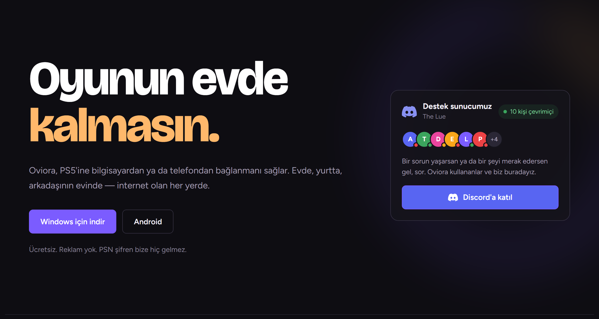
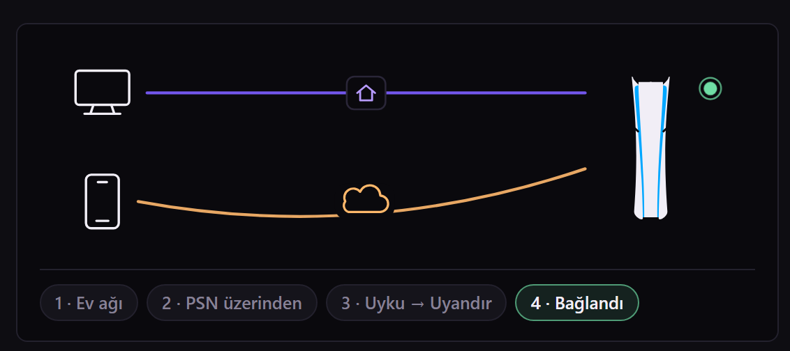
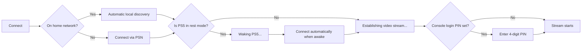
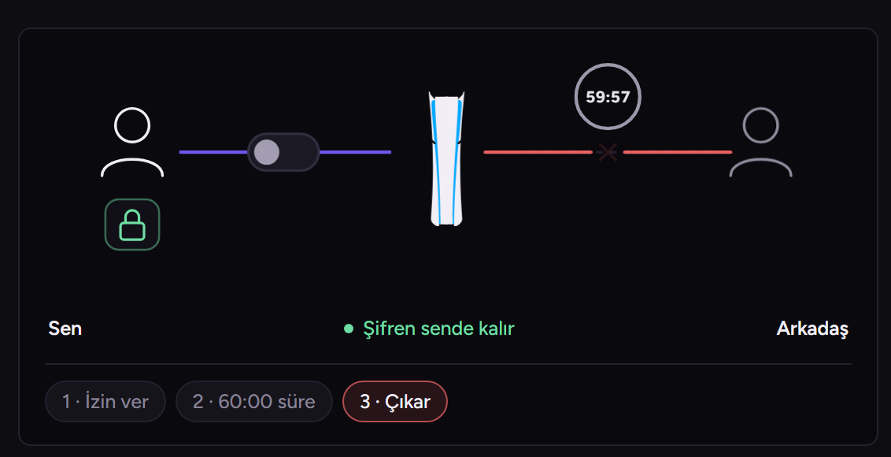
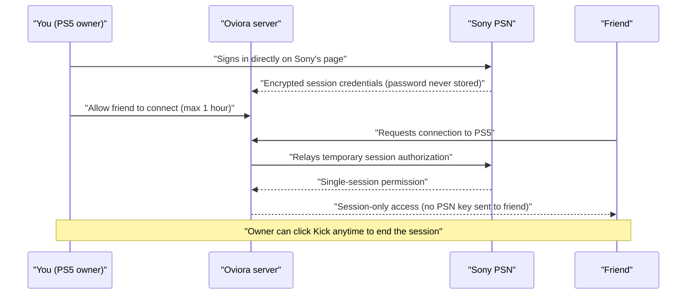
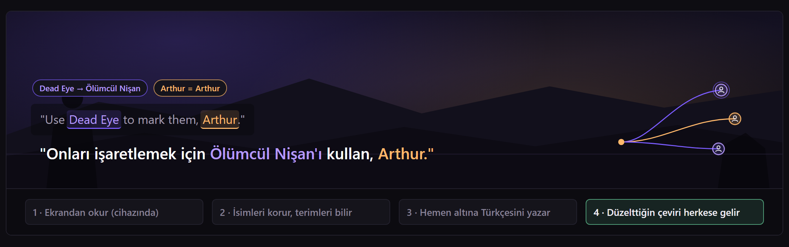
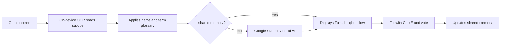
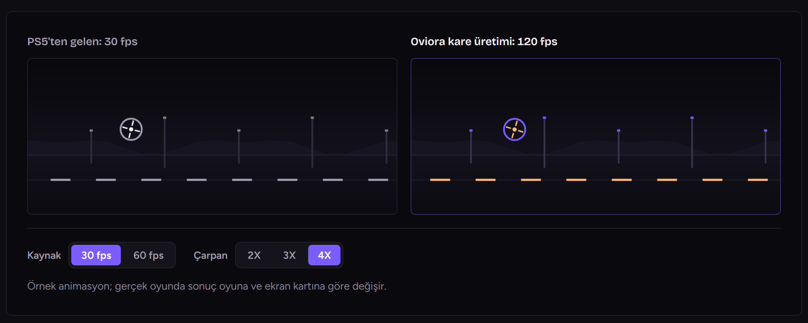

# Oviora

<p align="center">
  
</p>

<p align="center">
  <strong>Don't leave your game at home.</strong>
</p>

<p align="center">
  Oviora is an open-source Windows desktop client for connecting to your PlayStation 5 with low latency. Connect automatically on your home network or via PSN from anywhere, share your PS5 with friends, read live Turkish subtitles for English games, and clean up and smooth the video on supported NVIDIA RTX GPUs. Free and ad-free. Available in English, Turkish, and German.
</p>

<p align="center">
  <a href="https://oviora.tr/indir.php">Download</a> ·
  <a href="https://oviora.tr">Website</a> ·
  <a href="https://oviora.tr/hesap.php">Account</a> ·
  <a href="https://discord.gg/XRPXMCqCqe">Support (Discord)</a>
</p>

---

## What's inside

| Feature | What it does |
| --- | --- |
| Reach your PS5 from anywhere | Discovers your console automatically on your home network and connects via PSN when away. Wakes a resting PS5 remotely and connects as soon as it boots. |
| Share your PS5 with friends | You choose who can connect. Each session is limited to 1 hour and can be ended anytime with "Kick"; your PSN password is never shared. |
| Live Turkish subtitles | Reads on-screen English subtitles via on-device OCR and writes Turkish right below them, keeping proper names intact and game terms consistent. |
| Smoothness and picture enhancement | On NVIDIA RTX GPUs, cleans up compression artifacts, sharpens the picture, and applies super resolution. On RTX 40/50 GPUs, frame generation makes 30 fps games flow at 60/90/120 fps. |
| DualSense, keyboard, and mouse | Supports DualSense haptics, adaptive triggers, and gyro. Play with keyboard and mouse (F8 mouse aim) if needed, and type into PS5 text boxes with your PC keyboard. |
| Account, privacy, and security | Only a username and password are needed — no email. Updates are signed with Ed25519, and friend messages are end-to-end encrypted. |

---

## Reach your own PS5 from anywhere

At home, Oviora finds your PS5 on the local network automatically; pair once using the code shown on your console. Away from home, it connects via your PSN account. If your PS5 is in rest mode, Oviora wakes it remotely and connects as soon as the console comes up.

If your PS5 uses a 4-digit console sign-in PIN, a prompt appears during connection so you can enter it right from your PC. The connecting screen shows each stage (`Waking PS5…`, `Reaching PS5…`, `PS5 reached, establishing video…`, or retrying if needed), and you can cancel anytime with double `Esc`, right-click, or Circle on your controller.

<p align="center">
  
</p>



---

## Friends and PS5 sharing

Sharing your PS5 stays under the console owner's control at every step.

- **Adding friends:** Add friends by username or share an invite link and QR code. You can choose whether people joining via your invite need your approval first or become friends immediately.
- **Owner decides who connects:** Toggle which friends are allowed to access each of your PS5 consoles.
- **1-hour session limit and Kick:** A friend's session is capped at 1 hour, and you can end it anytime by clicking "Kick".
- **Queue and live game status:** If your PS5 is busy, friends can join a queue, see their position, and get notified when the console is free. Your friends list also shows which game is currently open on the console.
- **Your PSN password never goes to friends:** PSN sign-in happens directly on Sony's page. Your password or key is never sent to your friend; when a friend connects, the Oviora server relays the Sony authorization on your behalf for that session only.
- **End-to-end encrypted chat:** Message friends inside the app. Only you and your friend can read the messages; the Oviora server cannot read them.

<p align="center">
  
</p>



---

## Live Turkish subtitles

For games without Turkish support, Oviora reads on-screen English subtitles using on-device OCR and displays the Turkish translation right below them. Press `Ctrl+T` anytime to toggle subtitles, `Ctrl+B` to draw the subtitle box with your mouse, or `Ctrl+R` to view and adjust the capture area.

- **Proper names and game terms:** Names like Arthur or Los Santos stay untranslated, and game-specific terminology stays consistent via built-in glossaries.
- **Translation engines:** Choose Google (no key needed), DeepL (your own API key), or a local AI model running on your PC. You can also race the local AI against Google and show whichever responds first.
- **Local AI model (optional):** Downloadable in one click from Settings; every downloaded file is verified with SHA-256. Once installed, it translates without an internet connection.
- **Shared translation memory and voting:** Translated lines are cached in a shared memory so the same line appears right away for other players. You can fix any line in-game with `Ctrl+E` and vote on translations; your fixes reach everyone playing that game.

<p align="center">
  
</p>



<details>
<summary>Games with built-in term glossaries (20 games + general UI terms)</summary>

Glossary files live under `assets/altyazi/terim/`:

- General Game UI Terms (`genel.json`)
- Assassin's Creed Valhalla (`ac-valhalla.json`)
- Cyberpunk 2077 (`cyberpunk-2077.json`)
- Death Stranding (`death-stranding.json`)
- Elden Ring (`elden-ring.json`)
- Ghost of Tsushima (`ghost-of-tsushima.json`)
- God of War (2018) (`god-of-war-2018.json`)
- God of War Ragnarök (`god-of-war-ragnarok.json`)
- Grand Theft Auto V (`gta-v.json`)
- Hogwarts Legacy (`hogwarts-legacy.json`)
- Horizon Forbidden West (`horizon-forbidden-west.json`)
- Horizon Zero Dawn (`horizon-zero-dawn.json`)
- Marvel's Spider-Man (Remastered) (`spider-man-remastered.json`)
- Marvel's Spider-Man: Miles Morales (`spider-man-miles-morales.json`)
- Marvel's Spider-Man 2 (`spider-man-2.json`)
- Red Dead Redemption 2 (`rdr2.json`)
- Resident Evil 4 (2023) (`resident-evil-4.json`)
- The Last of Us Part I (`tlou-part-1.json`)
- The Last of Us Part II (`tlou-part-2.json`)
- The Witcher 3: Wild Hunt (`witcher-3.json`)
- Uncharted: Legacy of Thieves Collection (`uncharted-legacy-of-thieves.json`)

</details>

---

## Smoothness: ready for GTA 6

Your PS5 always outputs 60 frames per second. Most major games run at 30 fps in quality mode — for instance, if GTA 6 arrives at 30 fps, the console sends each real frame twice. Selecting **"30 FPS"** in Oviora skips the duplicate frames and generates intermediate frames only from real frames. That lets a 30 fps game look as smooth as 60, 90, or 120 fps, while 60 fps games can reach 120 fps and beyond.

- **Hardware and multiplier:** Frame generation runs on supported NVIDIA RTX GPUs (RTX 40 or 50 series recommended) with a 2X or higher multiplier depending on card support. Without a supported RTX GPU, these options stay off and the game plays normally.
- **Picture cleanup and enhancement:** Apply RTX Video Super Resolution (compression artifact reduction and upscaling), sharpening, anti-aliasing, RTX Video HDR, and Neural Rendering (NR) layers directly to the stream.
- **Quality presets:** Switch presets mid-game from the `Ctrl+O` stream menu: **Standard**, **High**, **High + sharp**, **Sharpest**, and **Custom**.
- **HUD masks (`Ctrl+M`):** Draw mask regions over UI elements such as minimaps or text that frame generation or filters might distort, and toggle those masks on or off anytime with `Ctrl+M`.

> **Honest note:** Frame generation increases visual smoothness only and does not reduce input latency. Controller responsiveness does not become faster and may add a slight amount of delay.

<p align="center">
  
</p>

---

## Controls

- **Full DualSense support:** Haptics, adaptive triggers, and gyro all work.
- **Keyboard and mouse:** Play without a controller using keyboard and mouse; toggle mouse aim with `F8` (or your chosen key) and remap any PlayStation button.
- **Type with your PC keyboard:** When a text box appears on your PS5, type directly from your PC keyboard.
- **Stream menu (`Ctrl+O`):** Open the overlay anytime with `Ctrl+O` (or `L1 + R1 + L3 + R3` by default on a controller) for audio, picture quality, subtitles, or putting the PS5 to rest.
- **Mask toggle (`Ctrl+M`):** Enable or disable your drawn effect-exclusion and protection masks without leaving the game.
- **Streamer mode:** Hides your username, IP addresses, console names, and friend/invite codes while sharing your screen.

---

## Account, privacy, and security

- **No email required:** A username and password are all you need to create an Oviora account.
- **Instant account deletion:** Delete your account, friends, shares, messages, and PSN link permanently anytime via *Settings > Account > Delete account* in the app or *Account > Delete account* on the website.
- **Your PSN password never reaches Oviora:** PSN login takes place directly on Sony's sign-in page.
- **Signed updates and file verification:** App updates are verified with Ed25519 signatures, and every downloaded update file as well as the optional local AI files are checked with SHA-256.
- **End-to-end encrypted messaging:** Friend messages are encrypted end-to-end.
- **Privacy policy:** [oviora.tr/gizlilik.php](https://oviora.tr/gizlilik.php)

---

## System requirements

| Component | Requirement |
| --- | --- |
| Operating system | Windows 10 or Windows 11 (64-bit) |
| Graphics card | Any DirectX 12 compatible GPU |
| RTX video enhancement | NVIDIA RTX GPU (Super Resolution, artifact reduction, RTX Video HDR) |
| Frame generation | NVIDIA RTX 40 or 50 series GPU (2X and up) |
| Turkish subtitles | No extra hardware needed; optional local AI model recommends 6 GB+ VRAM |
| Network and internet | Ethernet or 5 GHz Wi-Fi at home; at least 15 Mbps recommended over the internet |
| PS5 settings | Remote Play, *Stay Connected to the Internet*, and *Enable Turning On PS5 from Network* enabled |

---

## FAQ

<details>
<summary>How is it different from Sony's own app?</summary>

Oviora adds friend sharing, live Turkish subtitles, and RTX picture enhancement. Under the hood, it still connects using your PS5's built-in Remote Play.

</details>

<details>
<summary>Can my friend see my PSN password?</summary>

No. You sign in directly on Sony's own page, so your password never goes to Oviora or your friend. They only get temporary access for that session, and you can click "Kick" anytime.

</details>

<details>
<summary>Does it work without an NVIDIA RTX GPU?</summary>

Yes. Any DirectX 12 compatible GPU can stream your PS5 and run Turkish subtitles. Only the RTX picture enhancement and frame generation options stay off.

</details>

<details>
<summary>How fast does my internet need to be?</summary>

At home, Ethernet or 5 GHz Wi-Fi is enough. Over the internet, at least 15 Mbps is recommended, and upload speed at the PS5's location matters as well.

</details>

<details>
<summary>Does it cost anything?</summary>

No. Oviora is free and has no ads.

</details>

<details>
<summary>How do I delete my account?</summary>

Go to *Settings > Account > Delete account* in the app, or *Account > Delete account* at [oviora.tr/hesap.php](https://oviora.tr/hesap.php). Deletion is instant and permanent.

</details>

---

## Support

If you run into trouble or have a question, join our Discord server. You can also open it directly from the app via *Settings > Account > Support on Discord* or from the connection error screen.

- Discord: [https://discord.gg/XRPXMCqCqe](https://discord.gg/XRPXMCqCqe)

---

## Building (Windows)

<details>
<summary>Build instructions from source (Windows 64-bit)</summary>

This repository contains the source code for the Windows (64-bit) desktop client.

### Requirements

- Windows 10 or Windows 11 (64-bit)
- Visual Studio 2022 Build Tools (MSVC C++20 toolset and Windows 10/11 SDK with `dxc.exe`)
- CMake 3.24+ (Ninja recommended) and Python 3
- Qt 6.8 (`Core`, `Gui`, `Qml`, `Quick`, `QuickControls2`, `Widgets`, `Network`, `Concurrent`, plus `CorePrivate` and `GuiPrivate`)
- vcpkg / local dependencies: FFmpeg (`avcodec`, `avformat`, `swresample`, `swscale`; plus `avfilter` for default `OVIORA_ENABLE_DEINTERLACE=ON`), OpenSSL (`Crypto`), zlib, Opus, `json-c`, `libevent`, `miniupnpc`, `pkg-config`, SDL3 (`3.4.14`)
- Local SDKs: NVIDIA DLSS SDK 310.7 (`OVIORA_DLSS_SDK_ROOT`), NVIDIA Optical Flow SDK 5.0.7 (`OVIORA_NVOF_SDK_ROOT`)
- Optional: `OVIORA_LIBASS_ROOT`, `OVIORA_XESS_ROOT` (XeSS 3.0.2), `OVIORA_FIDELITYFX_ROOT` / `OVIORA_FIDELITYFX2_ROOT` (FidelityFX 1.1.4 / 2.3.0), `OVIORA_CUDA_DRIVER_INCLUDE_DIR`

### Configure and Build

From an "x64 Native Tools Command Prompt for VS 2022":

```powershell
cmake -S . -B build -G Ninja `
  -DCMAKE_BUILD_TYPE=Release `
  -DCMAKE_PREFIX_PATH="C:\path\to\Qt\6.8.x\msvc2022_64" `
  -DCMAKE_TOOLCHAIN_FILE="C:\path\to\vcpkg\scripts\buildsystems\vcpkg.cmake" `
  -DVCPKG_TARGET_TRIPLET=x64-windows-static `
  -DOVIORA_FFMPEG_ROOT="C:\path\to\ffmpeg-prefix" `
  -DOVIORA_BUILD_QML_UI=ON `
  -DOVIORA_ENABLE_REMOTEPLAY=ON `
  -DOVIORA_ENABLE_EXPERIMENTAL_DLSSNR=ON `
  -DOVIORA_DLSS_SDK_ROOT="C:\path\to\DLSS_SDK_310.7" `
  -DOVIORA_NVOF_SDK_ROOT="C:\path\to\Optical_Flow_SDK_5.0.7"

cmake --build build --target oviora_qml_ui
```

The resulting executable is written to `build\Oviora.exe`.

</details>

## License

The combined Oviora application is distributed under the **GNU Affero General Public License v3.0 (AGPL-3.0)**.

Platform and remote-play modules in this repository are licensed under AGPL-3.0-only (with the OpenSSL exception), while engine and video-processing modules remain under GNU GPL v3.0; they are combined into a single work pursuant to Section 13 of both GPLv3 and AGPLv3. Third-party license texts and attribution notices are provided in [THIRD_PARTY_NOTICES.md](THIRD_PARTY_NOTICES.md) and the `licenses/` directory.

PlayStation, PS5, and DualSense are trademarks of Sony Interactive Entertainment Inc. Oviora is not affiliated with Sony.

**Contact:** ARFEP IT-Service — info@arfep.de
